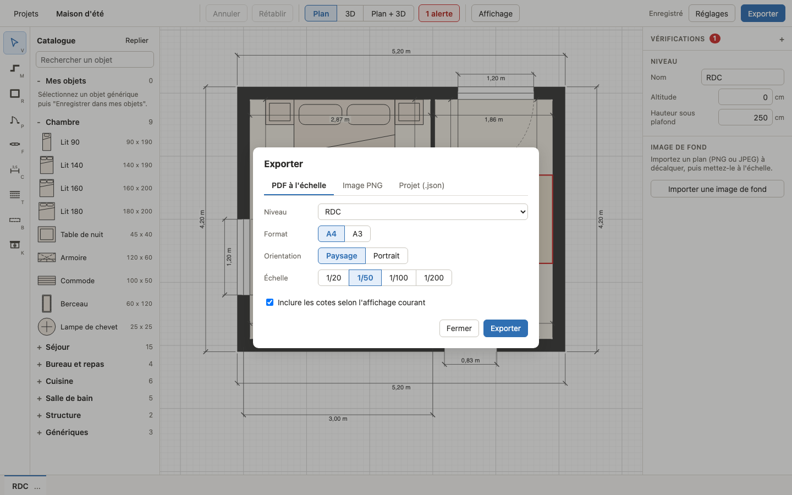
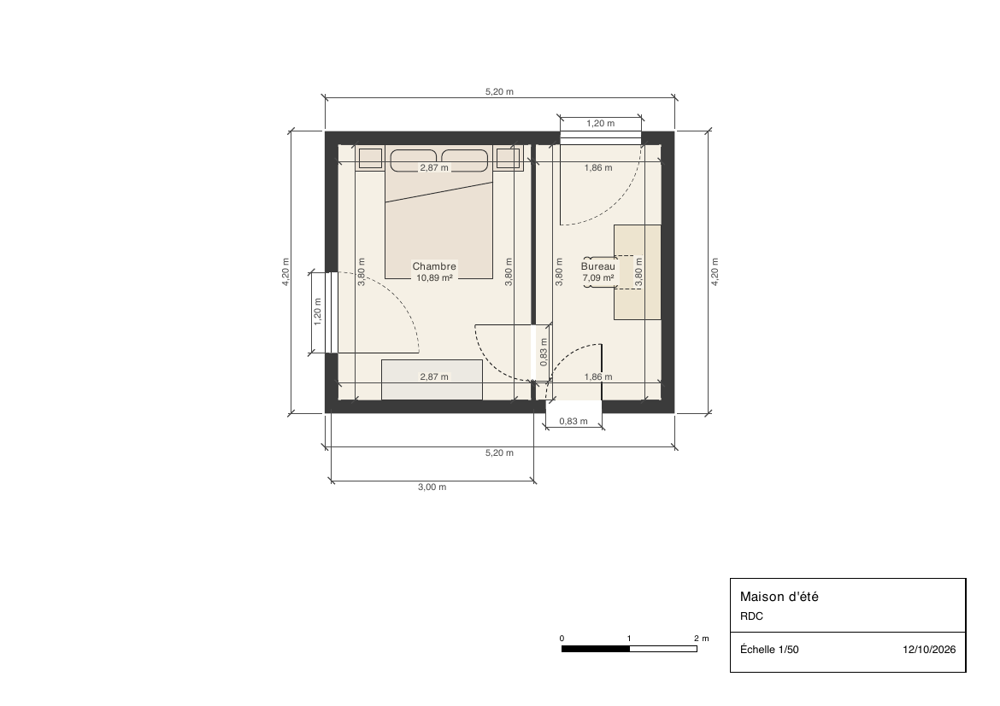

# Export et sauvegarde

## Où sont vos projets

Mansarde n'a ni serveur ni compte : vos projets sont enregistrés **dans votre navigateur**
(IndexedDB), sur votre ordinateur. Rien n'est envoyé sur Internet.

Conséquences à connaître :

- Chaque navigateur a ses propres projets. Chrome et Firefox, ou deux ordinateurs, ne voient pas
  les mêmes projets.
- Chaque **adresse** a aussi les siens : la version lancée en local (`http://localhost:5173`) et
  la version publiée (`https://feltrincyril.github.io/Mansarde/`) ne partagent rien. Le port
  compte : `localhost:5173` et `localhost:4173` sont deux adresses différentes.
- Effacer les données du site, ou utiliser la navigation privée, fait disparaître les projets.
  En navigation privée, le stockage peut même être refusé : l'accueil l'indique alors ("Le
  stockage du navigateur est indisponible...").

**Exportez régulièrement vos projets en `.json`** : c'est votre sauvegarde, et le seul moyen de
passer un projet d'un navigateur, d'un ordinateur ou d'une adresse à l'autre.

### Passer un projet d'un endroit à l'autre

1. Là où se trouve le projet : bouton "Exporter" de sa ligne sur l'écran des projets, ou, dans
   l'éditeur, "Exporter" puis l'onglet "Projet (.json)" et "Exporter le projet (.json)".
2. Là où vous voulez le retrouver : écran des projets, "Importer un projet", choisissez le
   fichier.

## L'écran des projets

- **"Nouveau projet"** : demande un nom ("Mon logement" proposé), puis ouvre le projet avec un
  niveau "RDC".
- **"Importer un projet"** : ajoute un projet depuis un fichier `.json` exporté par Mansarde.
- Chaque projet affiche un aperçu, son nom, sa date de modification et son nombre de niveaux, du
  plus récent au plus ancien, avec les boutons :
  - "Ouvrir" (un clic sur le nom ouvre aussi) ;
  - "Renommer" ;
  - "Dupliquer" : une copie indépendante nommée "<nom> - variante", images de fond comprises,
    pour essayer un autre aménagement sans toucher à l'original ;
  - "Exporter" : télécharge le projet en `.json` ;
  - "Supprimer" : après confirmation. C'est définitif : exportez d'abord le projet si vous
    voulez le garder.
- Un projet enregistré dans un format que cette version ne sait pas lire apparaît comme "Projet
  illisible" ("Format non reconnu par cette version de Mansarde."). Vous pouvez seulement le supprimer.

## Sauvegarde automatique

Chaque modification est enregistrée toute seule, une demi-seconde après la dernière. L'en-tête de
l'éditeur indique l'état : "Enregistrement...", "Enregistré", ou "Non enregistré" en cas
d'échec. Il n'y a pas de bouton Enregistrer.

Si un enregistrement échoue (stockage plein, par exemple), un bandeau rouge reste affiché ("La
sauvegarde a échoué : ...") avec un bouton "Exporter en .json" : exportez le projet pour ne rien
perdre. La version non enregistrée reste disponible tant que la page est ouverte.

Ce qui n'est pas enregistré dans le projet : l'historique d'annulation (vidé à la fermeture du
projet) et les choix d'affichage (cotes, grille, filigrane, disposition Plan / 3D, options de la
3D), qui valent pour la session.

## Exporter

Le bouton "Exporter" de l'en-tête ouvre la fenêtre "Exporter", avec trois onglets.

### "PDF à l'échelle"

| Option | Choix | Par défaut |
|---|---|---|
| "Niveau" | Les niveaux du projet | Le niveau actif |
| "Format" | "A4", "A3" | A4 |
| "Orientation" | "Paysage", "Portrait" | Paysage |
| "Échelle" | "1/20", "1/50", "1/100", "1/200" | 1/50 |
| "Inclure les cotes selon l'affichage courant" | Case à cocher | Cochée |

Le PDF contient :

- le plan à l'échelle exacte, en vectoriel, dessiné comme à l'écran mais sans la grille, le
  filigrane du niveau inférieur, la sélection ni les alertes ; l'image de fond est incluse si elle est visible ;
- les pentes, poutres et placards (les pentes en teinte uniforme) ;
- un cartouche en bas à droite : nom du projet, nom du niveau, échelle ("Échelle 1/50") et date
  du jour ;
- une barre d'échelle graphique (1 m au 1/20, 2 m au 1/50, 5 m au-delà).

Avec la case des cotes cochée, le PDF reprend le mode de cotes du menu "Affichage" ("Toutes les
cotes", "Cotes manuelles" ou "Aucune cote") ; décochée, il n'en a aucune.

Si le plan ne tient pas sur la page, la fenêtre le dit et propose une échelle qui convient :
"Le plan ne tient pas sur cette page à l'échelle 1/50. Échelle conseillée : 1/100.", avec un
bouton "Utiliser 1/100". Si même le 1/200 ne suffit pas, choisissez un format plus grand. Le plan
n'est jamais rogné.

Si des cotes automatiques deviennent illisibles à l'échelle choisie, elles sont retirées et la
fenêtre le signale, par exemple "3 cotes illisibles à cette échelle ont été masquées, essayez le
1/20.".

Le PDF utilise la police Helvetica : les accents français s'affichent, mais pas les caractères
hors de l'alphabet latin.

### "Image PNG"

- "Niveau" et la case des cotes, comme pour le PDF.
- "Résolution" : "1x", "2x" (par défaut) ou "4x". À 1x, un pixel représente un centimètre du
  plan.
- Le niveau est cadré sur son contenu, avec une marge.
- Une image trop grande est refusée ("Image trop grande : choisissez une résolution plus
  faible").

### "Projet (.json)"

"Exporter le projet (.json)" télécharge tout le projet, niveaux, "Mes objets" et images de fond
comprises. C'est le format de sauvegarde et d'échange : il se réimporte depuis l'écran des
projets.

### Noms des fichiers

- PDF et PNG : "<projet> - <niveau>.pdf" ou ".png".
- Projet : "<projet>.json".

Les caractères interdits dans un nom de fichier (`/ \ : * ? " < > |`) sont remplacés par "-".

Un niveau vide ne s'exporte pas en PDF ni en PNG ("Ce niveau est vide.").

## Importer

"Importer un projet", sur l'écran des projets, ajoute toujours un **nouveau** projet : rien
n'est écrasé. Si un projet porte déjà ce nom, le projet importé est renommé "<nom> (import)",
puis "<nom> (import 2)"... Un message confirme : "Projet importé : <nom>".

Un fichier refusé n'importe rien, avec un message qui dit pourquoi, par exemple :

- "Fichier illisible : ce n'est pas un fichier JSON valide." ;
- "Ce fichier ne provient pas de Mansarde." ;
- "Ce fichier a été créé par une version plus récente de Mansarde.".

Les fichiers exportés par une version plus ancienne de l'application sont convertis à
l'import.
