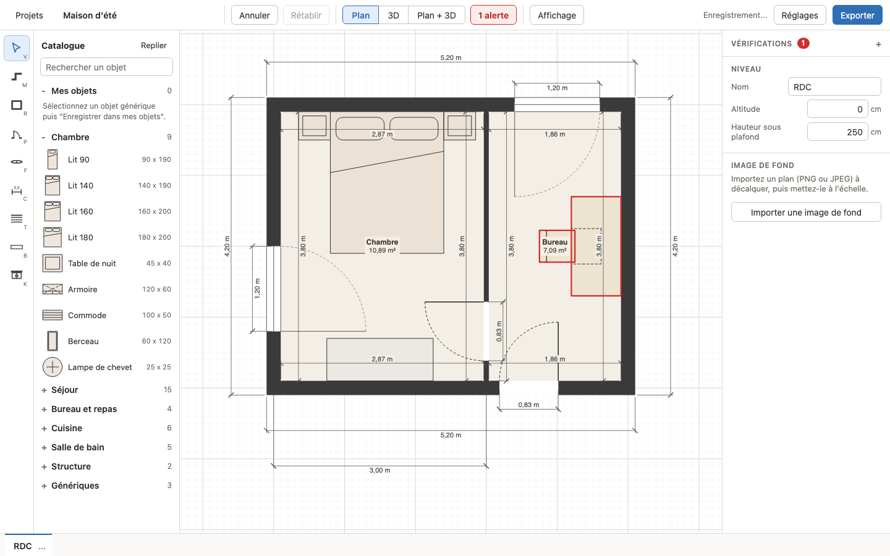

# Le plan 2D

Cette page décrit tout ce qui se dessine sur le plan : murs, pièces, ouvertures, cotes, ainsi que
la sélection, les niveaux et l'image de fond. Les pentes, poutres et placards ont leur page :
[Combles](combles.md). Les meubles aussi : [Objets et catalogue](objets.md).

## L'écran de l'éditeur

- **En-tête** : "Projets" (retour à la liste), le nom du projet (cliquez dessus pour le
  modifier), "Annuler" et "Rétablir", le choix "Plan", "3D" ou "Plan + 3D", le compteur
  d'alertes, le menu "Affichage", l'état de l'enregistrement, "Réglages" et "Exporter".
- **Barre d'outils**, à gauche : un bouton par outil, avec sa touche.
- **Catalogue**, à côté : les meubles à poser (bouton "Replier" pour gagner de la place).
- **Plan**, au centre.
- **Panneau de droite** : le panneau "Vérifications", puis les propriétés de la sélection. Sans
  sélection, il montre le niveau actif et son image de fond.
- **Onglets des niveaux**, en bas.

## Saisir des valeurs

- Les longueurs se tapent en centimètres : `350`, `82,5` ou `82.5`. Vous pouvez aussi écrire
  l'unité : `350 cm` ou `3,5 m`.
- Le plan affiche les longueurs en mètres (`3,50 m`) et les surfaces en m² (`12,40 m²`).
- Dans le panneau de droite, une valeur s'applique avec Entrée ou en quittant le champ ; Échap
  remet l'ancienne valeur. Une saisie illisible passe en rouge avec "Valeur invalide" et n'est
  pas appliquée.
- Une modification impossible (mur trop court pour ses ouvertures, dimension trop petite...) est
  refusée : le projet ne change pas et un message en bas de l'écran explique pourquoi.

## Se déplacer dans le plan

- **Trackpad** : deux doigts pour déplacer la vue, pincer pour zoomer.
- **Souris** : la molette zoome autour du curseur ; glisser avec le clic droit (ou le bouton du
  milieu) déplace la vue ; Maj + molette déplace horizontalement.
- **Clavier** : Espace + glisser déplace la vue (toujours le plan, même juste après un clic dans
  la 3D) ; sans sélection, les flèches la déplacent ; 0 affiche tout le niveau.
- Le "?" en bas à gauche du plan rappelle ces gestes.

## Réglages du projet

Le bouton "Réglages" ouvre "Réglages du projet" :

| Réglage | Valeur d'un projet neuf |
|---|---|
| "Épaisseur des murs" | 20 cm |
| "Épaisseur des cloisons" | 7 cm |
| "Hauteur sous plafond" | 2,50 m |
| "Pas de la grille" | 10 cm |

Ces valeurs s'appliquent aux prochains murs et niveaux créés, pas à ceux qui existent déjà.

## Les murs

### Tracer des murs (outil Mur, touche M)

1. Cliquez pour poser le premier point, puis cliquez pour chaque angle.
2. Pour finir : double-clic, Entrée ou Échap. Pour fermer le contour, cliquez sur le point de
   départ.
3. Pendant le tracé, Ctrl+Z retire le dernier point.

Pendant le tracé, une étiquette près du curseur indique l'angle et l'épaisseur utilisée
("Mur 20 cm"), et une cote dynamique donne la longueur du segment en cours. Si le tracé serait
refusé (géométrie impossible), l'aperçu passe en rouge.

**Longueur au clavier** : pendant le tracé, tapez un nombre. Un champ "Longueur" s'ouvre près du
curseur ; Entrée pose le point à cette distance, dans la direction de l'aperçu.

**Cloisons** : maintenez Ctrl (Cmd sur macOS) pendant un clic du tracé. Toute la suite de murs
prend alors l'épaisseur des cloisons des réglages ("Cloison 7 cm").

### Axe ou face

Avec l'outil Mur, une petite barre "Tracer sur" apparaît au-dessus du plan :

- **"Axe"** (par défaut) : vos clics tracent l'axe du mur, l'épaisseur se répartit des deux
  côtés.
- **"Face gauche"** ou **"Face droite"** : vos clics tracent une face du mur, l'épaisseur part de
  l'autre côté. Pratique pour relever un logement par l'intérieur.

Un appui bref sur Espace pendant le tracé inverse le côté (face gauche ou face droite). Le choix
est gardé pendant la session. "Face gauche" désigne le côté gauche de la ligne tracée, vue à
l'écran dans le sens du tracé.

### Magnétisme

Le curseur s'accroche, dans cet ordre de priorité, à moins de 8 pixels à l'écran :

1. aux extrémités et jonctions de murs ;
2. au milieu d'un mur, puis à son axe ;
3. à l'alignement horizontal ou vertical d'une jonction existante (un guide en pointillés
   l'indique) ;
4. aux angles multiples de 15 degrés par rapport au point précédent ;
5. à la grille.

Un repère sous le curseur montre où le point va s'accrocher : un carré sur une jonction, un
losange sur un mur (milieu, axe ou face), une croix sur la grille ou ailleurs. Le même repère
s'affiche quand vous tracez une pente ou une poutre, et quand vous déplacez avec l'outil
Sélection un angle de pièce, une extrémité de mur, ou l'extrémité d'une pente ou d'une poutre.

Maj force les angles droits. Alt désactive le magnétisme tant qu'il est maintenu.

### Jonctions et murs coupés

- Commencer ou finir un mur sur une jonction existante réutilise cette jonction.
- Commencer ou finir un mur au milieu d'un mur existant crée une jonction en T : le mur existant
  est coupé en deux à cet endroit. Un mur ne peut pas être coupé sous une porte, une fenêtre ou un
  placard ("Une ouverture est à cheval sur la jonction", "Un placard est à cheval sur la
  jonction").
- Les angles sont coupés proprement (onglets), y compris entre murs d'épaisseurs différentes et
  à angle non droit.

### Modifier un mur

- **Panneau "Mur"** (un mur sélectionné) : "Longueur" avec le "Point fixe" ("Début" ou "Fin")
  qui ne bouge pas, la longueur de chaque face ("Face gauche", "Face droite", en lecture
  seule), "Épaisseur" et "Hauteur". Un mur neuf prend la hauteur sous plafond des réglages.
- **Plusieurs murs sélectionnés** : "Épaisseur" et "Hauteur" s'appliquent à tous (champ vide si
  les valeurs diffèrent).
- **Glisser un mur** le déplace, par pas de la grille ; les murs reliés suivent.
- **Glisser une jonction** (cliquez près de l'extrémité d'un mur) déplace l'extrémité de tous les
  murs qui s'y rejoignent. Lâchée sur une autre jonction, elle fusionne avec elle ; lâchée sur
  l'axe d'un mur, elle s'y raccorde en T. Une jonction sélectionnée affiche "Jonction de murs"
  avec ses coordonnées.
- Les portes, fenêtres et placards suivent leur mur. Si le mur devient trop court pour eux, la
  modification est refusée ("Le mur est trop court pour ses ouvertures", "Le mur est trop court
  pour ses placards").
- **Supprimer un mur** supprime aussi ses portes, fenêtres et placards, et les cotes manuelles
  accrochées à ses extrémités.

## Les pièces

### Détection automatique

Une pièce apparaît dès que des murs ferment une surface. Une porte ne fusionne jamais deux pièces.
Chaque pièce affiche son nom ("Pièce" par défaut) et sa surface intérieure, placés à l'endroit le
plus dégagé de la pièce, même en L. Un bloc de murs isolé au milieu d'une pièce (un poteau, une
gaine) est retiré de sa surface.

### Tracer une pièce rectangulaire (outil Pièce rectangulaire, touche R)

Glissez d'un coin à l'autre : **le rectangle tracé est l'intérieur de la pièce**, les murs sont
construits à l'extérieur. Les cotes de l'aperçu sont les dimensions intérieures.

Pour des dimensions exactes, tapez pendant le glisser : la largeur, Tab, la profondeur, Entrée.
Vous pouvez lâcher la souris avant Entrée, le champ reste ouvert. Une valeur effacée laisse ce
côté suivre la souris.

Si un coin du rectangle s'accroche à un mur existant (pièce voisine), le tracé repasse à l'axe
des murs pour partager ce mur au lieu de le doubler ; l'aperçu l'indique : "Accroché à un mur :
cotes à l'axe".

Ctrl (Cmd) pendant le glisser trace la pièce en cloisons. Une pièce de moins de 10 cm de côté est
refusée ("Pièce trop petite").

### Nom et dimensions d'une pièce

- **Renommer** : double-cliquez dans la pièce et tapez le nom (Entrée pour valider, Échap pour
  annuler), ou utilisez le champ "Nom" du panneau "Pièce". Un nom vide redonne le nom par défaut.
- **Panneau "Pièce"** (cliquez dans la pièce) : "Nom", "Surface", et pour une pièce
  rectangulaire "Largeur intérieure" et "Profondeur intérieure", modifiables.
- **"Côté qui bouge"** : "Droite / bas" (par défaut) ou "Gauche / haut". Le mur de ce côté se
  déplace, les murs voisins s'allongent ou raccourcissent.
- Si ce mur est partagé avec une autre pièce, le panneau prévient : "La pièce voisine sera
  modifiée."
- **Double-clic sur une cote intérieure** d'une pièce rectangulaire : un champ s'ouvre avec la
  valeur, la nouvelle valeur redimensionne la pièce (côté droit ou bas).
- Une dimension impossible est refusée et reste en rouge avec sa raison, par exemple
  "Impossible de redimensionner cette pièce ainsi." ou "Dimension minimale : 10 cm.".

## Portes, fenêtres et passages

### Poser une ouverture (touches P et F)

Survolez un mur avec l'outil Porte ou Fenêtre : l'ouverture apparaît avec son vrai symbole,
centrée sous le curseur et recalée pour tenir dans le mur, avec ses distances aux murs voisins.
Elle s'ouvre du côté du mur où se trouve la souris. En rouge, elle ne tient pas. Cliquez pour
la poser ; l'outil reste actif pour la suivante. Alt la place au millimètre au lieu du
centimètre.

| Type | Largeur | Hauteur | Allège |
|---|---|---|---|
| Porte | 83 cm | 2,04 m | - |
| Fenêtre | 1,20 m | 1,35 m | 90 cm |
| Passage | 90 cm | 2,04 m | - |

Un passage (ouverture sans menuiserie) s'obtient en changeant le "Type" d'une porte.

### Panneau "Ouverture"

- "Type" : "Porte", "Fenêtre" ou "Passage". Changer de type reprend les dimensions par défaut du
  nouveau type ; si elles ne tiennent pas, largeur et hauteur sont conservées.
- "Variante" : pour une porte "Battante simple", "Battante double", "Coulissante",
  "Galandage" ; pour une fenêtre "Battant simple", "Battant double", "Coulissante", "Fixe".
- "Largeur", "Hauteur", "Allège" (fenêtres).
- "Côté des gonds" ("Début du mur" ou "Fin du mur") et "Sens d'ouverture" ("Côté gauche" ou
  "Côté droit").

### Déplacer une ouverture

Glissez-la le long de son mur, ou sur un autre mur. Les distances aux obstacles s'affichent ; une
position impossible (chevauchement d'une autre ouverture, hors du mur) est dessinée en rouge et
refusée. Pour une position exacte, utilisez les distances au clavier (plus bas).

## Les cotes

### Cotes automatiques

Le plan cote tout seul :

- chaque face intérieure de mur de chaque pièce (les dimensions intérieures) ;
- chaque face extérieure des murs de façade ;
- la largeur de chaque ouverture.

Une cote automatique dont le texte deviendrait illisible (vue trop dézoomée, texte sur un autre
texte) n'est pas dessinée. Zoomez pour la voir.

### Cotes manuelles (outil Cote, touche C)

Cliquez le premier point, le second, puis un troisième clic fixe le décalage de la ligne de cote.
Les points s'accrochent aux jonctions de murs et aux coins des objets, et la cote les suit quand
ils bougent ; Alt donne un point libre. La cote créée est sélectionnée et l'outil reste actif.

Une cote manuelle sélectionnée affiche "Valeur" et "Décalage" ; glissez-la pour changer son
décalage. Les cotes manuelles sont toujours dessinées.

### Afficher ou masquer

Le menu "Affichage" de l'en-tête propose :

- "Toutes les cotes", "Cotes manuelles" ou "Aucune cote" ;
- "Niveau inférieur en filigrane" ;
- "Grille".

Ces choix valent pour la session et ne sont pas enregistrés dans le projet.

### Cotes dynamiques et distances au clavier

- Pendant le tracé d'un mur : la longueur du segment en cours.
- Pendant le déplacement d'un objet seul : les distances de ses bords à la face de mur la plus
  proche, dans ses quatre directions.
- Pendant le déplacement d'une ouverture : ses distances le long du mur, jusqu'aux murs ou aux
  ouvertures voisines.

**Placer à une distance exacte** : pendant le déplacement, ou avec un seul objet ou une seule
ouverture sélectionné, appuyez sur Tab pour choisir la cote (Maj+Tab en arrière), tapez la
distance voulue, puis Entrée. `0` plaque l'élément contre la face. Une ouverture ne peut pas
sortir de l'intervalle entre ses deux obstacles ("Pas assez de place sur ce mur").

## Sélectionner et modifier

- **Clic** sur un élément : le sélectionne. Clic dans une pièce : sélectionne la pièce. Clic dans
  le vide : vide la sélection.
- **Maj+clic** : ajoute ou retire un élément.
- **Rectangle de sélection** : glissez depuis le vide ou depuis l'intérieur d'une pièce. Il prend
  les éléments entièrement à l'intérieur : objets, ouvertures, murs, cotes manuelles, placards,
  poutres et pentes (jamais les pièces ni les jonctions).
- **Plusieurs éléments** : le panneau "Sélection" indique leur nombre et les propriétés
  communes (murs : épaisseur et hauteur ; objets : hauteur, hauteur de pose et couleur).
- **Déplacer** : glissez la sélection, ou utilisez les flèches (1 cm, 10 cm avec Maj). Chaque
  geste compte pour une seule étape d'annulation. Sans sélection, les flèches déplacent la vue.
- **Supprimer** : touche Suppr, Retour arrière, ou bouton "Supprimer" du panneau.
- **Dupliquer** : bouton "Dupliquer" du panneau (au-dessus de "Supprimer") ou Ctrl+D, pour les
  objets, placards, pentes et poutres. La copie garde toutes les propriétés, est décalée de
  20 cm et sélectionnée, prête à être déplacée ; une seule annulation la retire.
- **Copier, coller** : Ctrl+C, Ctrl+V, pour les objets (coller à nouveau continue le décalage).
- **Annuler, rétablir** : Ctrl+Z, Ctrl+Maj+Z ou Ctrl+Y, ou les boutons de l'en-tête.
  L'historique dure jusqu'à la fermeture du projet.

## Niveaux et variantes

Les onglets en bas de l'écran représentent les niveaux, du plus bas (à gauche) au plus haut (à
droite). Un projet neuf a un niveau "RDC".

- **Clic** sur un onglet : rend le niveau actif. **Double-clic** : le renomme.
- **Menu du niveau** (clic droit sur l'onglet, ou bouton "...") :
  - "Ajouter au-dessus" (nommé "Étage 1", "Étage 2"...) ou "Ajouter en dessous" ("Sous-sol",
    "Sous-sol 2"...) ;
  - "Dupliquer (variante)" : une copie complète nommée "<nom> - variante", placée juste après
    le niveau, à la même altitude, pour essayer un autre aménagement ;
  - "Monter", "Descendre" : changent l'ordre des onglets ;
  - "Supprimer" : après confirmation ; Annuler le fait revenir. Un projet garde au moins un
    niveau.
- **Panneau "Niveau"** (rien de sélectionné) : "Nom", "Altitude" et "Hauteur sous plafond". Un
  niveau ajouté au-dessus prend l'altitude du niveau de référence plus sa hauteur et 20 cm de
  dalle.
- **Filigrane** : avec "Niveau inférieur en filigrane" (menu "Affichage", actif par défaut), les
  murs du niveau placé juste avant dans les onglets apparaissent en gris clair, pour aligner les
  étages.

Pour une variante du projet entier, utilisez "Dupliquer" sur l'écran des projets (voir
[Export et sauvegarde](export-et-sauvegarde.md)).

## Image de fond à décalquer

Pour relever un plan existant (plan d'architecte, scan, photo), rien de sélectionné, section
"Image de fond" du panneau de droite :

1. **"Importer une image de fond"** (PNG ou JPEG). L'image arrive à 1 cm par pixel, centrée sur
   la vue, à moitié transparente.
2. **"Mettre à l'échelle"** : cliquez deux points de l'image dont vous connaissez la distance
   (une cote du plan, la longueur d'un mur), puis tapez la longueur réelle en cm. L'image est
   redimensionnée, le premier point reste en place.
3. **"Déplacer l'image"** : glissez sur le plan pour la caler, puis "Terminer".
4. Tracez vos murs par-dessus.

Réglages de l'image : "Largeur" et "Hauteur" (en lecture seule), "Opacité", "Rotation",
"Verrouiller" (l'image ne peut plus être déplacée ; la mise à l'échelle reste possible et
prévient qu'elle la déplacera), "Masquer", "Remplacer l'image" et "Supprimer l'image" (après
confirmation, annulable).

Chaque niveau a sa propre image. Une image visible est reprise dans les exports PNG et PDF.
