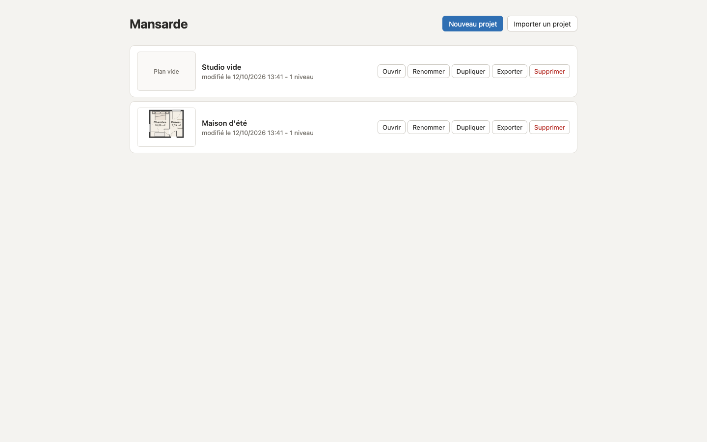

# Prise en main : un premier projet

Ce pas à pas dessine une chambre de 4,00 x 3,50 m intérieurs, avec une porte, une fenêtre, des
meubles et un rampant, puis la regarde en 3D et l'imprime en PDF. Comptez dix minutes.

Mansarde s'utilise sur ordinateur, à la souris et au clavier, dans Chrome ou Edge (navigateurs
sur lesquels elle est testée). Les longueurs se tapent en centimètres.

## 1. Créer le projet

1. Ouvrez Mansarde (la [version en ligne](https://feltrincyril.github.io/Mansarde/) ou la version
   locale, voir le [README](../../README.md#lancer-en-local)).
2. Sur l'écran des projets, cliquez "Nouveau projet", tapez un nom ("Ma chambre"), puis "Créer".

L'éditeur s'ouvre sur un plan vide, avec un niveau "RDC" en bas de l'écran.

## 2. Dessiner la pièce

1. Appuyez sur **R** (outil "Pièce rectangulaire").
2. Appuyez sur le bouton de la souris dans le plan et commencez à glisser.
3. Sans lâcher, tapez `400` : un champ s'ouvre près du curseur. Appuyez sur **Tab**, tapez `350`,
   puis **Entrée**. Lâchez la souris.
4. Appuyez sur **V** (outil "Sélection"), puis sur **0** pour tout afficher.

Les quatre murs sont construits **autour** du rectangle tracé : la pièce mesure bien 4,00 x
3,50 m à l'intérieur. Elle affiche son nom ("Pièce") et sa surface, 14,00 m².

Double-cliquez dans la pièce, tapez `Chambre`, puis Entrée pour la renommer.

Pour dessiner des murs un par un (pièce en L, cloison), utilisez l'outil Mur (**M**) : voir
[Le plan 2D](plan-2d.md#les-murs).

## 3. Ajouter une porte et une fenêtre

1. Appuyez sur **P** et survolez le mur du bas : la porte apparaît, ancrée au mur. Cliquez pour
   la poser.
2. Appuyez sur **F**, survolez le mur du haut, cliquez pour poser la fenêtre.
3. Appuyez sur **Échap** pour revenir à l'outil Sélection.

Cliquez sur la porte : le panneau "Ouverture", à droite, règle sa largeur, sa variante, le côté
des gonds et le sens d'ouverture. Glissez-la pour la faire coulisser le long du mur.

## 4. Meubler

1. Dans le catalogue, à gauche, ouvrez "Chambre" et glissez "Lit 140" dans la pièce, près d'un
   mur : il se plaque contre le mur.
2. Glissez une "Table de nuit" à côté du lit.
3. Le lit sélectionné, appuyez sur **Tab** : une cote de dégagement s'allume. Appuyez encore sur
   Tab pour choisir la bonne, tapez `60`, puis Entrée : le lit est à exactement 60 cm de ce mur.

La poignée ronde au-dessus d'un objet le fait tourner, les poignées carrées le redimensionnent.
Le panneau "Objet" donne toutes ses dimensions. Détail : [Objets et catalogue](objets.md).

## 5. Ajouter un rampant

1. Appuyez sur Échap pour ne rien sélectionner. Dans le panneau "Niveau", mettez la "Hauteur
   sous plafond" à `240`, puis Entrée.
2. Appuyez sur **T** (outil "Pente"). Cliquez sur le mur du haut, au milieu de la pièce, puis sur
   le mur du bas, juste en face : c'est la ligne où le plafond commence à descendre.
3. Déplacez la souris vers la droite jusqu'au mur de droite, puis cliquez.
4. Tapez `240` (hauteur au départ), **Tab**, `150` (hauteur à l'arrivée), **Entrée**.

La moitié droite de la pièce se teinte de bleu, avec des lignes de hauteur tous les 20 cm.
Glissez maintenant une "Armoire" (catalogue "Chambre") contre le mur de droite : elle est
entourée de rouge et l'en-tête affiche "1 alerte". Cliquez sur ce compteur : le panneau
Vérifications explique "Armoire : monte à 2,00 m, plafond à ... à cet endroit.".

Les alertes ne bloquent rien : déplacez l'armoire sous le plafond haut, l'alerte disparaît.
Détail : [Combles](combles.md) et [Vérifications](verifications.md).

## 6. Regarder en 3D

1. Cliquez "Plan + 3D" dans l'en-tête : la 3D s'affiche à côté du plan.
2. Glissez dans la 3D pour tourner, pincez ou utilisez la molette pour zoomer, glissez à deux
   doigts ou avec le clic droit pour déplacer la vue.
3. Cliquez dans la pièce sur le plan, puis "Depuis la pièce sélectionnée" : vous êtes dans la
   chambre, à hauteur d'yeux.

Modifiez un meuble sur le plan : la 3D suit aussitôt. Détail : [La vue 3D](vue-3d.md).

## 7. Imprimer en PDF

1. Cliquez "Exporter" dans l'en-tête.
2. Onglet "PDF à l'échelle" : gardez "A4", "Paysage" et "1/50".
3. Cliquez "Exporter" : le PDF se télécharge, avec un cartouche et une barre d'échelle.

## Et ensuite

- Il n'y a rien à enregistrer : chaque modification est sauvegardée dans le navigateur.
- Pensez à exporter le projet en `.json` de temps en temps (onglet "Projet (.json)") : c'est
  votre sauvegarde. Voir [Export et sauvegarde](export-et-sauvegarde.md).
- Tous les raccourcis : [Raccourcis](raccourcis.md).
