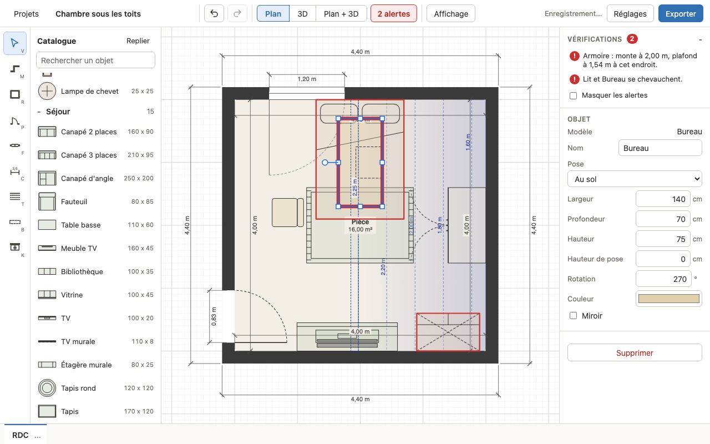

# Vérifications automatiques

Mansarde contrôle en permanence le niveau actif et signale ce qui coince : un meuble trop haut
sous un rampant, deux meubles qui se chevauchent, une porte qui ne peut plus s'ouvrir... Ces
alertes ne bloquent jamais une action : vous pouvez toujours poser, déplacer ou garder un
élément en alerte. Elles ne sont jamais imprimées ni exportées.

## Où voir les alertes

- **Compteur de l'en-tête** : "1 alerte", "3 alertes"... Il est rouge s'il y a au moins une
  erreur, orange s'il n'y a que des avertissements, et absent quand tout va bien. Un clic dessus
  ouvre le panneau Vérifications.
- **Panneau "Vérifications"**, en haut du panneau de droite (cliquez sur son titre pour l'ouvrir
  ou le replier) : une ligne par alerte, les erreurs d'abord, avec une marque rouge (erreur) ou
  orange (avertissement). "Aucune alerte." quand il n'y a rien. Au-delà de 200 lignes, le reste
  est résumé ("N autres alertes").
- **Clic sur une ligne** : sélectionne les éléments concernés et centre le plan sur eux.
- **Sur le plan** : les éléments en alerte sont entourés de rouge ou d'orange.
- **Dans la 3D** : les meubles et placards en alerte sont teintés de rouge ou d'orange.

### Masquer les alertes

La case "Masquer les alertes", en bas du panneau Vérifications, retire les contours du plan et
la teinte de la 3D. Le compteur et la liste restent : rien n'est oublié, c'est seulement plus
calme à l'écran.

## Les contrôles

Les messages ci-dessous sont ceux de l'application ; `<Nom>` est le nom de l'objet, ou
"Placard" pour un placard. Deux éléments de même nom sont numérotés dans les messages
("Bureau (1)", "Bureau (2)") : renommer ses meubles rend la liste plus lisible. Un objet sans nom
s'appelle "Objet".

| Contrôle | Message | Gravité |
|---|---|---|
| Hauteur sous plafond | "`<Nom>` : monte à 2,00 m, plafond à 1,54 m à cet endroit." | Erreur |
| Placard sans hauteur | "Placard : pas assez de hauteur sous le plafond." | Erreur |
| Chevauchement | "`<Nom>` et `<Nom>` se chevauchent." | Erreur |
| Empiètement sur un mur | "`<Nom>` : empiète sur un mur." | Erreur |
| Ouverture gênée | "`<Nom>` : gêne l'ouverture de la porte." ou "`<Nom>` : gêne l'ouverture du placard." | Erreur |
| Placard devant une ouverture | "Placard : devant une porte.", "Placard : devant un passage." | Erreur |
| Placard devant une fenêtre | "Placard : devant une fenêtre." | Avertissement |
| Objet dans le vide | "`<Nom>` : aucun support en dessous." | Avertissement |
| Passage devant un placard | "Placard : 40 cm de passage devant (60 cm conseillés)." | Avertissement, erreur sous 30 cm |

Les valeurs (2,00 m, 1,54 m, 40 cm) sont des exemples : le message donne les vraies.

### Hauteur sous plafond

Le haut d'un objet (hauteur de pose plus hauteur) dépasse de plus de 1 cm le plafond le plus bas
au-dessus de son emprise, en tenant compte des pentes et des poutres. Contrôle aussi les placards
de hauteur fixe. Ne sont pas contrôlés : les placards "Jusqu'au plafond" (ils suivent le
plafond) et les escaliers (catégorie Structure), qui traversent le plafond vers l'étage.

### Placard sans hauteur

Un placard "Jusqu'au plafond" dont le dessus passe sous le haut de son socle. Le panneau refuse
de créer ce cas, mais il peut apparaître après coup : pente ajoutée, poutre, hauteur du niveau
abaissée, fichier importé.

### Chevauchement

Deux objets, ou un objet et un placard, ou deux placards, dont les emprises au sol se recouvrent
de plus de 1 cm² et qui se recouvrent aussi en hauteur (de plus de 1 cm). Une étagère murale au-dessus
d'une commode ne se heurte donc pas à elle. Ne comptent pas :

- un tapis (pose "Revêtement") avec tout ce qui n'est pas un tapis ;
- un objet "Rangé dessous" sous une table, une table basse ou un bureau du catalogue ;
- un objet "Posé sur un meuble" avec le meuble qui le porte.

Deux tapis qui se chevauchent sont signalés.

### Empiètement sur un mur

L'emprise d'un objet (sauf un tapis) ou d'un placard entre de plus de 1 cm² dans un mur. Les
embrasures des portes et fenêtres comptent comme du mur.

### Ouverture gênée

Un objet (sauf un tapis) dont le dessous est à moins de 2 m du sol mord sur la zone balayée par
le vantail d'une porte battante (simple ou double) ou par une porte battante de placard. Les
portes coulissantes et à galandage ne balaient rien. Un seul message par objet et par porte ou
placard.

### Placard devant une ouverture

Un placard dont la largeur, le long de son mur, recouvre une ouverture de ce mur (quelle que soit
la face), et qui monte de plus de 1 cm dans cette ouverture. Un placard bas sous l'allège d'une
fenêtre n'est donc pas signalé. Erreur devant une porte ou un passage, avertissement devant une
fenêtre.

### Objet dans le vide

Un objet "Posé sur un meuble" dont le dessous est à plus de 1 cm du sol, sans rien pour le porter
à cette hauteur (à 1 cm près) sous son centre. Peuvent porter un objet : les objets au sol, les
objets rangés dessous, l'étagère murale et les placards de hauteur fixe.

### Passage devant un placard

La distance libre devant la façade du placard, sur toute sa largeur, jusqu'au premier obstacle :
un objet (sauf un tapis, et sauf s'il est à plus de 2 m du sol), un autre placard ou un mur. Une
porte ou un passage en face compte comme un mur. Sous 60 cm c'est un avertissement, sous 30 cm une
erreur. Quand l'obstacle est un objet ou un placard, il est aussi sélectionné par un clic sur la
ligne.
