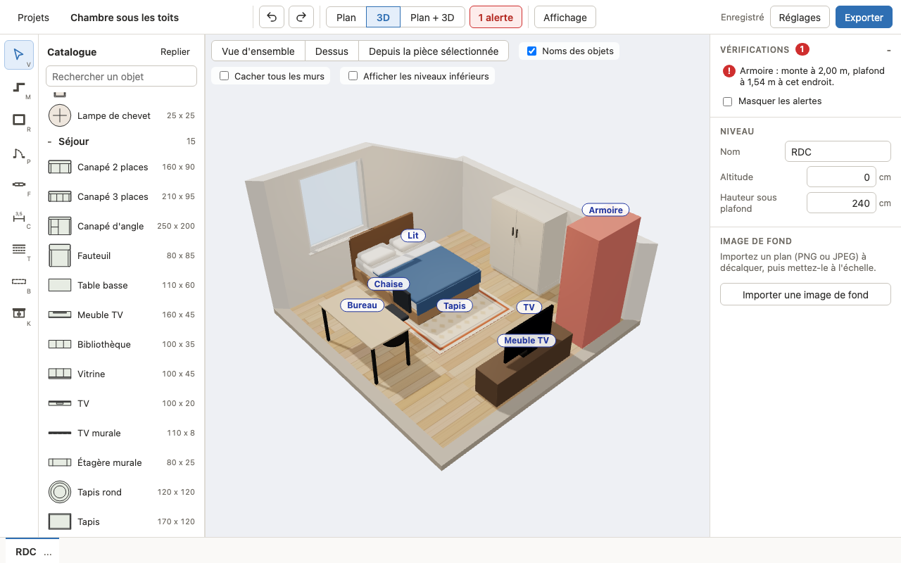
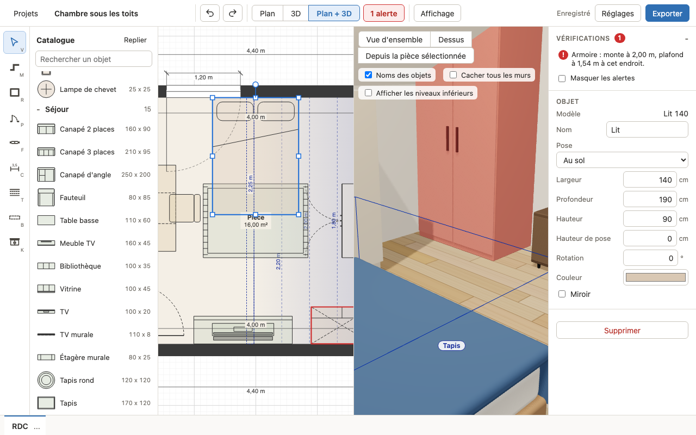

# La vue 3D

La vue 3D montre le niveau actif en volume : murs, sols en parquet, plafonds et rampants, poutres,
placards, portes et fenêtres, meubles. Elle sert à regarder ; toutes les modifications se font sur
le plan et apparaissent aussitôt dans la 3D.

## Afficher la 3D

Les boutons de l'en-tête choisissent la disposition :

- **"Plan"** : le plan seul ;
- **"3D"** : la 3D sur toute la largeur ;
- **"Plan + 3D"** : les deux côte à côte. La séparation se déplace à la souris, ou avec les
  flèches gauche et droite quand elle a le focus.

La 3D est chargée au premier affichage ("Chargement de la 3D..."), ce qui peut prendre un
instant. En vue "3D" seule, les raccourcis du clavier (annuler, supprimer...) continuent de
fonctionner.

## Naviguer

- Glisser avec le bouton gauche : tourner autour de la scène.
- Déplacer la vue : deux doigts sur le trackpad, glisser avec le bouton droit, ou Maj + glisser.
- Zoomer : pincer sur le trackpad, ou molette.
- Clavier : après un clic dans la 3D, sans sélection, les flèches déplacent la vue (Maj +
  flèches : tourner) ; avec une sélection, elles décalent la sélection, comme dans le plan.
- Le "?" en bas à gauche de la vue rappelle ces gestes.

La caméra ne passe pas sous le sol, et le zoom arrière est limité à la taille du niveau.

## Vues prédéfinies

Trois boutons en haut de la vue y emmènent la caméra en douceur :

- **"Vue d'ensemble"** : le niveau entier, vu de biais et d'en haut ;
- **"Dessus"** : le niveau vu presque à la verticale ;
- **"Depuis la pièce sélectionnée"** : la caméra se place dans la pièce sélectionnée (ou celle de
  l'objet sélectionné), à 1,60 m du sol, près de son bord, à l'écart des meubles hauts et sous le
  plafond, et regarde vers le centre de la pièce. Sans pièce sélectionnée, c'est la vue
  d'ensemble.

Tant que vous ne tournez ni ne zoomez, la vue reste cadrée sur sa vue prédéfinie, même si la
fenêtre ou la séparation change de taille. Un simple clic de sélection ne la quitte pas.

## Murs et plafonds masqués

Pour voir l'intérieur depuis l'extérieur, la vue masque toute seule :

- les murs situés entre la caméra et le point qu'elle regarde ;
- vue de l'extérieur, les murs de façade tournés vers la caméra (avec leurs portes et fenêtres) ;
- les plafonds, rampants et poutres quand la caméra est au-dessus d'eux.

La case **"Cacher tous les murs"** retire tous les murs, plafonds et poutres, pour voir
l'aménagement en entier.

## Noms des objets

La case **"Noms des objets"** (cochée par défaut) affiche une étiquette avec le nom de chaque
meuble. Décochez-la pour une vue plus épurée.

## Niveaux inférieurs

La case **"Afficher les niveaux inférieurs"** empile sous le niveau actif les niveaux placés
avant lui dans les onglets, à leur altitude. Ils sont montrés en transparence, avec leurs murs,
leur dalle et leurs sols, sans les meubles.

## Sélectionner dans la 3D

Un clic sur un meuble, un placard ou une poutre le sélectionne : il est entouré en bleu et son
panneau s'ouvre à droite, comme sur le plan. Un clic sur le sol ou sur un mur vide la sélection.
Un glisser (pour tourner) ne sélectionne rien.

Une sélection faite sur le plan apparaît aussi en bleu dans la 3D.

## Couleurs et alertes

- Un objet du catalogue qui garde sa couleur par défaut prend en 3D des teintes de matériaux
  (bois, tissu, motif de tapis) ; une couleur choisie dans le panneau "Objet" est respectée.
- Les meubles et placards en alerte sont teintés de rouge (erreur) ou d'orange (avertissement).
  La case "Masquer les alertes" du panneau Vérifications retire cette teinte.

## Si la 3D ne s'affiche pas

- Si le navigateur ne sait pas afficher la 3D (WebGL indisponible), la vue indique "La 3D n'est
  pas disponible sur ce navigateur." Le plan reste entièrement utilisable.
- Si la 3D rencontre une erreur, elle affiche "La vue 3D a rencontré un problème." avec un
  bouton "Réessayer". Elle réessaie aussi d'elle-même à la modification suivante du niveau.

La 3D sollicite la carte graphique : sur un ordinateur sans accélération graphique, elle peut être
lente.
